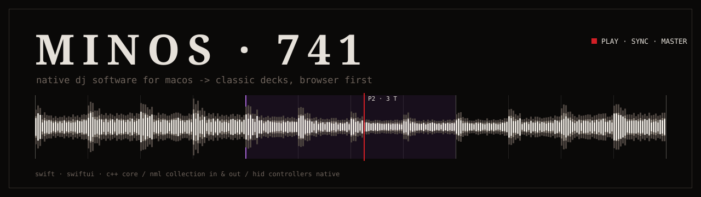

     

native dj software for macos.

* download: [MINOS-741.dmg](https://github.com/Slayer7411/MINOS-741-releases/releases/download/latest-build/MINOS-741.dmg) · [all releases](https://github.com/Slayer7411/MINOS-741-releases/releases)
* homebrew: `brew install --cask slayer7411/tap/minos-741`
* page: https://slayer7411.github.io/MINOS-741-releases/
* bugs and ideas: [issues](https://github.com/Slayer7411/MINOS-741-releases/issues)
* user guide: [slayer7411.github.io/MINOS-741/guide](https://slayer7411.github.io/MINOS-741/guide/)

## ◆ LICENSE

GPL-2.0-or-later. this repository holds builds only. complete corresponding source code of any build is available on request for three years from that build's release -> [open an issue](https://github.com/Slayer7411/MINOS-741-releases/issues). name, ◆ mark and logo stay with the author.

full text: [LICENSE.md](LICENSE.md).
